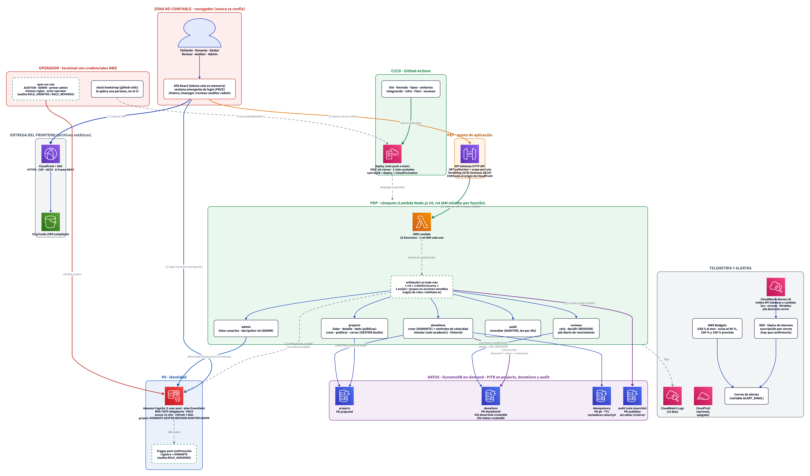

# Arquitectura actual de AQP-SOLIDARIA

Describe **lo que está implementado hoy** en `infra/template.yaml` y `backend/src`, no lo que se planeó. Para la comparación entre versiones (actual, mejorada, ideal) ver [arquitectura-comparacion.md](arquitectura-comparacion.md); para el porqué de cada decisión, [decisiones-y-comportamientos.md](decisiones-y-comportamientos.md); para el mapeo a NIST SP 800-207, [nist-800-207-mapping.md](nist-800-207-mapping.md).

- Última actualización: 2026-11-09.
- Todo lo descrito sale de leer la plantilla y el código, y está cubierto por las pruebas indicadas. Lo que **no** existe está en la sección 9.



Fuente editable: [diagrams/zta-architecture-current.d2](diagrams/zta-architecture-current.d2) (también hay una versión [SVG](diagrams/zta-architecture-current.svg)). Los iconos de AWS se descargan al renderizar (hace falta internet) y quedan incrustados: el SVG pesa unos 80 KB y el PNG unos 1.6 MB.

## 1. En una página

Plataforma de donaciones **serverless** en AWS, con un enfoque Zero Trust (NIST SP 800-207): nunca se confía en el navegador, cada petición se autentica y se autoriza, y todo lo que cambia estado queda auditado.

| Capa | Qué es |
|---|---|
| Frontend | SPA React 19 + Vite + Tailwind, servida por CloudFront desde un bucket S3 privado. Los tokens viven solo en memoria. |
| Identidad (PA) | Un user pool de Amazon Cognito, con MFA TOTP obligatorio, Authorization Code + PKCE y cinco grupos que son los roles. |
| Punto de aplicación (PEP) | API Gateway HTTP API con authorizer JWT de Cognito y un *scope* OAuth por ruta. |
| Decisión (PDP) | AWS Lambda (Node.js 24, TypeScript). Toda ruta pasa por `withAuth()`; cada función tiene su propio rol IAM con lo mínimo. |
| Datos | Cuatro tablas DynamoDB bajo demanda. La de auditoría es de solo inserción. |
| Operación | CloudWatch Logs, CloudTrail, GuardDuty y Security Hub (los tres últimos opcionales por parámetro). CI/CD con GitHub Actions y OIDC, sin claves guardadas. |

## 2. Etapas: `academic` y `production`

Una sola plantilla con el parámetro `StageName`.

| | `academic` | `production` |
|---|---|---|
| Función `SimulateDonation` y su ruta | Existe | **No existe** |
| CORS | CloudFront y `http://localhost:3000` | Solo CloudFront |
| URL de retorno de Cognito | CloudFront y localhost | Solo CloudFront |
| Protección contra borrado de las tablas | No | Sí |
| Recuperación a un punto en el tiempo (PITR) | Parámetro `EnablePitr` | Siempre activa |
| Controles de velocidad, cola de revisión, administración de roles | Sí | Sí |

La etapa `production` es una plantilla de contraste: sin `SimulateDonation` no hay quién confirme una donación (no existe pasarela de pagos). Ver [decisiones-y-comportamientos.md](decisiones-y-comportamientos.md), A4.

## 3. Componentes

### 3.1 Frontend y entrega
- **SPA:** páginas por rol (`/history`, `/manager`, `/reviews`, `/auditor`, `/admin`) y catálogo público. Oculta lo que el rol no puede usar, pero eso es solo comodidad: el backend decide siempre.
- **Tokens solo en memoria** (`InMemoryWebStorage`), nunca en `localStorage` ni `sessionStorage`. Recargar obliga a pulsar «Iniciar sesión» (ver A1 de las decisiones).
- **Login:** ventana emergente con la página de Cognito (el SPA nunca ve la contraseña); si el navegador la bloquea, continúa en la página completa.
- **CloudFront + OAC** hacia un bucket S3 privado. Cabeceras de seguridad: CSP, HSTS (1 año, con subdominios y preload), `X-Frame-Options: DENY`, `nosniff` y `Referrer-Policy`.

### 3.2 Identidad: Cognito (PA)
- **MFA TOTP obligatorio** para todo el pool (Cognito no lo aplica por grupo). Sin SMS.
- **Tokens:** access e ID de 15 minutos, refresh de 7 días con revocación activa. El «Salir» revoca el refresh token y cierra también la sesión de Cognito.
- **Registro abierto.** Un *trigger* de post-confirmación (`AddDonorToGroup`) da el rol DONANTE a quien confirma su correo, y a nadie más.
- **Grupos = roles:** DONANTE, GESTOR, REVISOR, AUDITOR, ADMIN.
- **Scopes** (servidor de recursos `api`): `projects.write`, `donations.write`, `donations.read`, `audit.read`, `donations.review` y `admin.users`.

### 3.3 Punto de aplicación: API Gateway (PEP)
- HTTP API con authorizer JWT. Una ruta protegida sin token o con un ID token (o sin el scope de la ruta) se rechaza en el gateway, antes de invocar la función.
- **Limitación de tasa:** 25 req/s con ráfaga 50 por ruta; las tres lecturas públicas de proyectos, 10/20. Es global por ruta, no por usuario (por eso hay un control por donante en el backend).
- Registro de acceso en CloudWatch Logs.

### 3.4 Decisión: `withAuth()` y las funciones (PDP)
Toda función de API se exporta con `withAuth()`; una prueba falla si una ruta de la plantilla no lo usa (solo se exceptúan el trigger de Cognito y el job programado). El orden de las comprobaciones es:

1. **Rol:** el grupo que exige la acción, y que la combinación de roles de la persona sea válida (`roleRules.ts`).
2. **Recurso y dueño:** carga el recurso y compara su dueño.
3. **Sesión y grupos, solo en acciones sensibles:** llama a `userInfo` de Cognito y relee los grupos actuales (`AdminListGroupsForUser`). Falla cerrado.
4. Ejecuta la lógica, **audita** y traduce cualquier error a una respuesta sin filtrar detalles internos.

Rutas y funciones (16 en `academic`: 14 de API, el trigger y el job; 15 en `production`):

| Función | Ruta | Scope | Rol | Sensible | Tablas que toca |
|---|---|---|---|:-:|---|
| ListProjects | `GET /v1/projects` | pública | | | projects (lee) |
| GetProject | `GET /v1/projects/{id}` | pública | | | projects (lee) |
| GetProjectStats | `GET /v1/projects/{id}/stats` | pública | | | projects (lee) |
| CreateProject | `POST /v1/projects` | `projects.write` | GESTOR | | projects, audit |
| PublishProject | `PATCH /v1/projects/{id}/publish` | `projects.write` | GESTOR | sí | projects, audit |
| CloseProject | `PATCH /v1/projects/{id}/close` | `projects.write` | GESTOR (el que lo creó) | sí | projects (lee y actualiza), audit |
| CreateDonation | `POST /v1/donations` | `donations.write` | DONANTE | | projects (lee), donations, idempotency, audit |
| SimulateDonation | `POST /v1/donations/{id}/simulate` | `donations.write` | DONANTE (dueño) | al confirmar | projects, donations, audit — solo `academic` |
| GetMyDonations | `GET /v1/donations/me` | `donations.read` | DONANTE | | donations (lee), audit |
| ListReviews | `GET /v1/reviews` | `donations.review` | REVISOR | | donations (índice de estado), audit |
| ReviewDonation | `POST /v1/donations/{id}/review` | `donations.review` | REVISOR | sí | projects (lee), donations, audit |
| ListUsers | `GET /v1/admin/users` | `admin.users` | ADMIN | sí | audit (Cognito: lista usuarios y grupos) |
| ChangeUserRole | `POST /v1/admin/users/{id}/roles` | `admin.users` | ADMIN | sí | audit (Cognito: añade o quita grupos) |
| GetAuditEvents | `GET /v1/audit` | `audit.read` | AUDITOR | sí | audit (lee) |
| ExpireReviews | *(sin ruta: EventBridge, 1 vez al día)* | | sistema | | donations, audit |
| AddDonorToGroup | *(Cognito, post-confirmación)* | | sistema | | audit (Cognito: añade al grupo DONANTE) |

La matriz de permisos IAM exacta por función está en [specs/002-zta-hardening/contracts/iam-permissions-matrix.md](../specs/002-zta-hardening/contracts/iam-permissions-matrix.md) y la comprueba `backend/test/infra/iamMatrix.test.ts`.

### 3.5 Datos: DynamoDB (bajo demanda)

| Tabla | Clave | Índices | Notas |
|---|---|---|---|
| projects | `projectId` | | Guarda `createdBy` (no se expone) y `confirmedAmountCents`. |
| donations | `donationId` | `donorSub-createdAt-index` (historial propio), `status-createdAt-index` (cola de revisión y vencimiento) | Estados: `PENDIENTE_SIMULACION`, `CONFIRMADA_SIMULADA`, `RECHAZADA_SIMULADA`, `EN_REVISION`, `RECHAZADA_REVISION`. |
| idempotency | `pk` | TTL en `expiresAt` | Claves de idempotencia y contadores de velocidad (`velocity#…`, por minuto y por hora). |
| audit | `auditDay` + `timestamp#eventId` | | Una partición por día UTC. Solo inserción: una política de recurso niega a los roles de las funciones `UpdateItem`, `DeleteItem` y `BatchWriteItem`, y cada evento se escribe con `attribute_not_exists`. |

La consistencia se logra con **transacciones y escrituras condicionales**: crear una donación escribe en una sola transacción la clave de idempotencia, la donación y los dos contadores de velocidad; confirmar y decidir una revisión solo se aplican si el estado sigue siendo el esperado.

### 3.6 Auditoría
- `recordAuditEvent` es el único punto de escritura. El actor se **seudonimiza** (`usr_…`, hash del `sub`); nunca se guarda el correo ni el `sub`.
- Se audita cada denegación de ruta protegida y cada éxito de una acción que cambia estado. Un fallo al escribir la auditoría se registra y no cambia la respuesta.
- Tipos: `AUTHZ_DECISION`, `PROJECT_CREATED`, `PROJECT_PUBLISHED`, `DONATION_CREATED`, `DONATION_TRANSITIONED`, `ROLE_ASSIGNED`, `DONATION_RATE_LIMITED`, `SUSPICIOUS_VELOCITY`, `REVIEW_DECISION`, `REVIEW_EXPIRED`, `ROLE_GRANTED`, `ROLE_REVOKED`. Detalle en [audit-event.md](../specs/002-zta-hardening/contracts/audit-event.md).
- Actores especiales: `system` (job programado) y `operator` (script de roles).

### 3.7 Telemetría
CloudWatch Logs con retención de 14 días (funciones en JSON y registro de acceso del API). Los rechazos esperados (4xx y el 503 por contención) se registran como `warn`; los fallos reales, como `error`. CloudTrail, GuardDuty y Security Hub son parámetros opcionales (apagados en `samconfig.toml`).

### 3.8 CI/CD
- **GitHub Actions:** lint, formato, tipos, pruebas unitarias, de integración (DynamoDB Local), de infraestructura, emulador (Floci con IAM activo), escaneo de IaC y de dependencias. El trabajo `deploy` depende de **todos** los anteriores.
- **Despliegue** solo con push a `main`, con OIDC y **dos roles acotados**: uno que GitHub asume (maneja el stack con conjuntos de cambios) y otro que solo CloudFormation usa (crea los recursos, limitado a los nombres de la aplicación).
- **El stack de bootstrap** (`infra/bootstrap/github-oidc.yaml`) crea esa identidad y **no lo despliega el CI**: lo aplica una persona.

## 4. Flujos principales

### 4.1 Iniciar sesión
SPA → ventana emergente de Cognito (Hosted UI) → usuario y contraseña + código TOTP → Cognito devuelve un código → el SPA lo cambia por tokens con PKCE → los tokens quedan en memoria. El access token lleva los grupos (`cognito:groups`) y los scopes.

### 4.2 Crear una donación (con controles de velocidad)
1. El API Gateway valida el JWT y el scope `donations.write`; `withAuth` exige DONANTE.
2. La función valida el cuerpo, la cabecera `Idempotency-Key` (UUID) y que el proyecto exista, esté publicado y **no sea del propio donante**.
3. Lee la ventana horaria del donante y decide: si el total de la hora supera S/ 5,000 o hay 3 donaciones de al menos S/ 900, la donación queda `EN_REVISION`; si no, `PENDIENTE_SIMULACION`.
4. Escribe **en una sola transacción** la clave de idempotencia, la donación y los contadores. Si el contador del minuto ya está en 5, la transacción se cancela y responde **429**. Si la clave ya existía, devuelve la donación original. Ante contención reintenta con retroceso exponencial y, agotado el margen, responde **503** con `Retry-After`.
5. Audita `DONATION_CREATED` (y `SUSPICIOUS_VELOCITY` si quedó retenida).

### 4.3 Revisar una donación retenida
El REVISOR ve la cola (índice por estado, de la más antigua a la más reciente, con un seudónimo del donante y el motivo) y decide `APROBAR` o `RECHAZAR` con un motivo de 10 a 500 caracteres. Reglas: no sobre una donación propia ni de un proyecto que creó (403 `CONFLICT_OF_INTEREST`); acción sensible; la escritura exige `status = EN_REVISION`, así que de dos decisiones simultáneas solo una vale (la otra recibe 409). Un job diario rechaza como `RECHAZADA_REVISION` las que lleven más de 7 días sin revisar.

### 4.4 Administrar roles
- **Desde la aplicación:** el ADMIN lista las personas y da o quita DONANTE, GESTOR y REVISOR. No cambia sus propios roles ni los de quien es AUDITOR o ADMIN (403), valida la combinación antes de escribir (409) y audita `ROLE_GRANTED` o `ROLE_REVOKED` con seudónimos.
- **Desde la terminal:** `npm run role` hace lo que la pantalla no puede (AUDITOR, ADMIN y el primer administrador), con las mismas reglas, plan previo y registro con actor `operator`.

## 5. Roles y combinaciones

| | DONANTE | GESTOR | REVISOR | AUDITOR | ADMIN |
|---|:-:|:-:|:-:|:-:|:-:|
| **DONANTE** | n/a | sí | sí | no | no |
| **GESTOR** | sí | n/a | no | no | no |
| **REVISOR** | sí | no | n/a | no | no |
| **AUDITOR** | no | no | no | n/a | no |
| **ADMIN** | no | no | no | no | n/a |

Una sola fuente: `backend/src/shared/roleRules.ts`. Quien combina roles incompatibles recibe 403 `SEPARATION_OF_DUTIES` en toda acción protegida. Cognito sí permite asignar esa combinación; por eso se valida al asignar (pantalla y script) y de nuevo al usar.

## 6. Dónde se aplica cada principio Zero Trust

| Principio | Dónde se cumple en esta arquitectura |
|---|---|
| Nunca confiar, verificar siempre | JWT y scope en el gateway; rol, dueño y sesión en el backend; las acciones sensibles releen los grupos en Cognito. |
| Mínimo privilegio | Un rol IAM por función con acciones y tablas mínimas; `UpdateItem` de `CreateDonation` acotado a claves `velocity#*`; las funciones de administración solo tocan el pool y la auditoría. |
| Separación de funciones | Tabla de combinaciones; cuatro ojos en la revisión y en la administración de roles. |
| Asumir la brecha | Tokens de 15 minutos y en memoria; auditoría de solo inserción; seudonimización; límites por donante. |
| Verificar con evidencia | Pruebas unitarias, de integración, de infraestructura y contra un emulador de AWS con IAM activo. |

Mapeo completo a NIST SP 800-207: [nist-800-207-mapping.md](nist-800-207-mapping.md).

## 7. Parámetros de la plantilla

| Parámetro | Efecto | Por defecto |
|---|---|---|
| `StageName` | `academic` o `production` | |
| `CognitoDomainPrefix` | Prefijo del dominio del Hosted UI (único en todo AWS) | |
| `EnablePitr`, `EnableCloudTrail`, `EnableGuardDuty`, `EnableSecurityHub` | Servicios opcionales | apagados en `samconfig.toml` |
| `VelocityMaxPerMinute` | Donaciones nuevas por donante y minuto antes del 429 | 5 |
| `VelocityReviewThresholdCents` | Total horario que retiene la donación | 500000 (S/ 5,000) |
| `VelocityStructuringCount` | Donaciones de al menos el 90 % del máximo por hora que la retienen | 3 |
| `ReviewExpiryDays` | Días antes de que el job rechace una donación sin revisar | 7 |

## 8. Dónde está cada cosa

| Qué | Dónde |
|---|---|
| Infraestructura | `infra/template.yaml`; identidad del CI en `infra/bootstrap/github-oidc.yaml` |
| Reglas de roles | `backend/src/shared/roleRules.ts` |
| Autorización y auditoría | `backend/src/authz/`, `backend/src/audit/` |
| Módulos | `backend/src/{projects,donations,reviews,admin,identity}/` |
| Script de roles | `backend/scripts/setRole.ts` (`npm run role`) |
| Frontend | `frontend/src/{auth,pages,components,services}/` |
| Contratos | `specs/002-zta-hardening/contracts/` y `docs/api.yaml` |
| Pruebas | `backend/test/` (unit, `integration/`, `infra/`, `floci/`, `browser/`) |

## 9. Qué no se usa, por costo o por alcance

Aquí se aclara **qué servicio se dejó fuera o apagado y por qué**, para que nadie lo lea como un olvido. El detalle completo, con la razón de cada ausencia y qué haría falta para añadirla, está en [mejoras-consideradas.md](mejoras-consideradas.md).

**Certeza de cada dato:** *Precio AWS* (lista de precios oficial, `us-east-1`, 2026-11-09), *Docs AWS* (documentación oficial, 2026-11-09), *Cuenta real* (AWS CLI, solo lecturas) o *Repo* (afirmado en el proyecto, no verificado). Los importes mensuales suponen 730 horas y **no incluyen impuestos ni transferencia de datos**. La lista de precios **no trae los tramos gratuitos**, así que esos siguen sin verificarse.

### 9.1 Dejados fuera o apagados por costo

| Servicio | Estado | Costo (`us-east-1`) | Certeza |
|---|---|---|---|
| **Cognito Plus** (protección contra amenazas) | No se usa | USD 0.020 por usuario activo al mes (Essentials, USD 0.015; Lite, USD 0.0055) | Docs AWS (funciones de Plus). Precio AWS |
| **GuardDuty** | Apagado (`EnableGuardDuty=false`) | 30 días de prueba; después, p. ej. USD 4.00 por millón de eventos de CloudTrail analizados | Docs AWS. Precio AWS. Cuenta real: no activado |
| **Security Hub** | Apagado (`EnableSecurityHub=false`) | 30 días de prueba; después cobra por hora y por eventos analizados | Docs AWS. Precio AWS. Cuenta real: no activado |
| **CloudTrail** | Opcional; **apagado en `samconfig.toml`** | Eventos gratuitos y de pago (USD 2.00 por 100,000 eventos de pago); la primera copia de gestión es gratuita por coherencia con la lista | Precio AWS. Cuenta real: **ningún trail** |
| **PITR de DynamoDB** | Apagado (`EnablePitr=false`; en `production` siempre activo) | USD 0.20 por GB al mes: centavos con estos volúmenes | Precio AWS. Cuenta real: apagado en las 4 tablas |
| **Claves KMS propias** | No se usan | USD 1.00 al mes por clave; DynamoDB ya cifra sin cargo con claves de AWS | Docs AWS. Precio AWS |
| **VPC con NAT** | Las funciones **no** están en una VPC | NAT: USD 0.045 por hora (unos USD 32.85 al mes) más USD 0.045 por GB | Docs AWS. Precio AWS |
| **Verified Permissions (Cedar)** | No se usa; el motor es un módulo propio | USD 5.00 por millón de solicitudes simples | Precio AWS. Que sea la fase 2, Repo |
| **SMS para MFA** | No se usa; solo TOTP | Cobra por mensaje | Repo (ya excluido en `specs/001`) |
| **Organizations / IAM Identity Center** | No se usan | Convierte la cuenta en plan de pago | Repo |

### 9.2 Dejados fuera por una limitación técnica (el costo es secundario)

| Servicio | Estado | Por qué | Certeza |
|---|---|---|---|
| **AWS WAF** | No se usa | **Un HTTP API no admite WAF** (un REST API sí). Con CloudFront delante costaría USD 5.00 al mes por web ACL y USD 1.00 por regla | Docs AWS. Precio AWS |
| **Load balancer (ALB)** | No existe | Innecesario: API Gateway ya es el punto de entrada y Lambda escala sola. Costaría unos USD 16.43 al mes fijos | Código. Precio AWS |
| **Límite de tasa por usuario en el gateway** | No existe | Los planes de uso por cliente son solo de REST API. El límite por donante está en el backend | Docs AWS |
| **Cognito managed login (v2)** | No se usa; se usa el Hosted UI clásico | Exige Essentials o Plus. Ver el aviso de abajo | Docs AWS |

> **Nota sobre Cognito.** El plan del pool es `ESSENTIALS` y desde ahora la plantilla lo **declara** (`UserPoolTier: ESSENTIALS`): antes era solo el valor por defecto de CloudFormation y nadie lo había elegido (D15 en [decisiones-y-comportamientos.md](decisiones-y-comportamientos.md)). Todo lo que el proyecto usa está también en **Lite**, que cuesta unas 2.7 veces menos por usuario activo; con unos 8 usuarios la diferencia son centavos y el tramo gratuito no figura en la lista de precios. Pasar a Lite exige probar antes la revocación de tokens, `userInfo` y el cierre de sesión (sección 8 de [mejoras-consideradas.md](mejoras-consideradas.md)).

### 9.3 Que no existen por alcance, no por costo
- **Pasarela de pagos:** la confirmación es simulada y solo existe en `academic`.
- **Cierre automático de campaña (por meta o por fecha):** no existe a propósito. El cierre es manual, por el gestor que creó el proyecto (D19); llegar a la meta no cierra nada y la interfaz muestra el porcentaje real.
- **Gestión de cuentas:** no hay pantalla para crear, borrar o deshabilitar usuarios; el alta es por registro abierto. Sí existe la administración de **roles** (rol ADMIN y `npm run role`). Lo que falta es el flujo para que una persona **solicite** el rol de gestor (la otra mitad de T106).

### 9.4 Lo que el proyecto exige desde el principio y la cuenta real no tiene
- **Alerta de gasto en AWS Budgets.** Aparece en la primera especificación (`specs/001`, RNF-09), en [requirements.md](../requirements.md) (CA-NF09.1) y en `design.md`; el plan de `specs/001` incluso la da por configurada «desde el día 1» para mitigar el riesgo de facturación inesperada. **Ya está en la plantilla** (recurso `CostBudget`, D14), pero **solo se crea si se define la variable `ALERT_EMAIL`** y se aplicó antes el stack de bootstrap con el permiso `budgets`. Mientras eso no se haga, la cuenta sigue sin presupuesto. La lista de precios no cobra una alerta de gasto por correo (solo los presupuestos *con acciones* y los informes enviados). El resto de P7 (alarmas) sigue pendiente.
- **Alarmas de CloudWatch y SNS:** ya están en la plantilla (D17): cuatro alarmas (5xx del API, errores de Lambda, ejecuciones rechazadas por concurrencia y el job diario sin ejecutarse) y un tópico SNS con suscripción por correo. Se crean con la misma variable `ALERT_EMAIL`, tras reaplicar el bootstrap, y hay que confirmar la suscripción desde el correo. Cuestan USD 0.10 por alarma al mes, y las primeras 1,000 notificaciones de correo de SNS al mes son gratuitas.
- **Cuenta de operación.** Hoy se opera con la cuenta root de AWS (P3).

### 9.5 Resumen de la cuenta real (2026-11-09)

| Qué se comprobó | Resultado |
|---|---|
| Plan del user pool | ESSENTIALS (el valor por defecto), MFA activado |
| Trails de CloudTrail | Ninguno |
| GuardDuty y Security Hub | No activados en la cuenta |
| PITR en las 4 tablas | Apagado (D18 lo activa en el próximo despliegue) |
| Presupuestos (AWS Budgets) | `aqp-solidaria-academic-monthly`, USD 5 al mes (comprobado con el AWS CLI tras el despliegue) |
| Concurrencia de Lambda de la cuenta | Límite de 10 ejecuciones, todas sin reservar (por eso no se puede reservar concurrencia por función) |
| Alarmas de CloudWatch | Ninguna |

## Cómo mantener este documento
Cuando cambie la plantilla (funciones, rutas, tablas, parámetros) o el código de autorización, se actualiza aquí y se regenera el diagrama:

```bash
cd docs/diagrams
d2 --pad 30 zta-architecture-current.d2 zta-architecture-current.svg
d2 --pad 30 zta-architecture-current.d2 zta-architecture-current.png
```

Las cifras de la sección 3.4 (16 funciones, 14 rutas) las fijan `backend/test/infra/iamMatrix.test.ts` y `backend/test/floci/stackDeployment.test.ts`: si cambian, esos tests fallan antes que este documento quede desactualizado.
