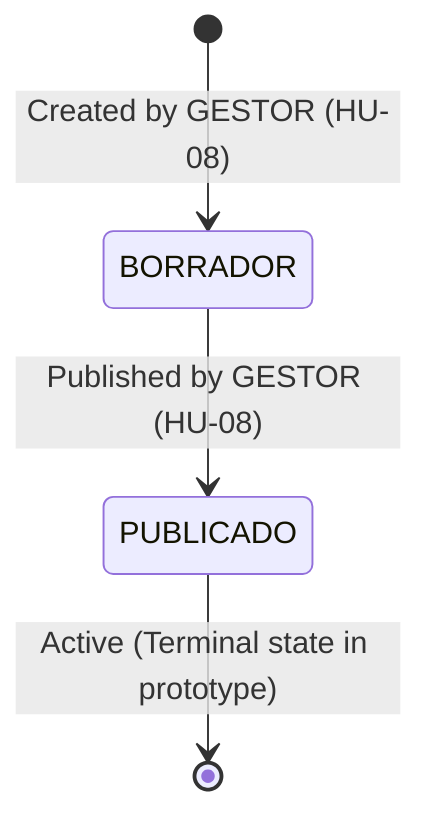
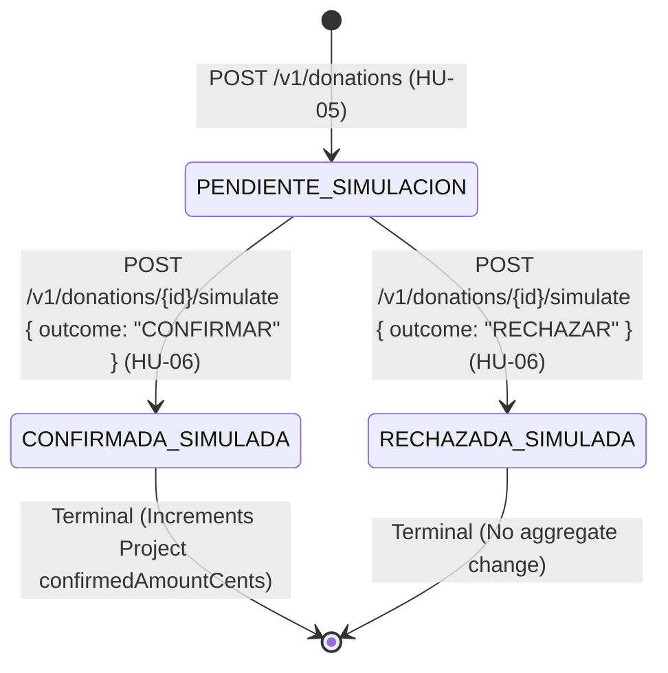

# Data Model Specification: Plataforma de Donaciones Seguras

**Feature Branch**: `001-secure-donations`  
**Date**: 2026-11-06  
**Status**: Approved  
**Traced Requirements**: [requirements.md §4](../../requirements.md#4-modelo-de-datos-l%C3%B3gico-m%C3%ADnimo), [design.md §5](../../design.md#5-modelo-de-datos-y-consistencia)

---

## 1. Physical Storage Architecture (Amazon DynamoDB)

Persistence uses Amazon DynamoDB with On-Demand capacity mode. Partition and Sort keys are structured to satisfy access patterns with minimum latency, consistent reads where required, and zero table scans.

```mermaid
erDiagram
    PROJECT ||--o{ DONATION : "receives"
    DONATION ||--o| IDEMPOTENCY_RECORD : "guaranteed by"
    USER ||--o{ DONATION : "donates"
    AUDIT_EVENT }|--|| PROJECT : "tracks"
    AUDIT_EVENT }|--|| DONATION : "tracks"

    PROJECT {
        string projectId PK
        string title
        string description
        int goalAmountCents
        int confirmedAmountCents
        string currency
        string status
        string createdAt
        string updatedAt
    }

    DONATION {
        string donationId PK
        string projectId FK
        string donorSub
        int amountCents
        string currency
        string status
        string createdAt
        string updatedAt
    }

    IDEMPOTENCY_RECORD {
        string pk PK "donorSub#operation#idempotencyKey"
        string payloadHash "SHA-256"
        string donationId
        int responseStatus
        int expiresAt "TTL"
    }

    AUDIT_EVENT {
        string eventType PK
        string timestamp_eventId SK
        string eventId
        string timestamp
        string requestId
        string actorRef
        string resourceRef
        string action
        string outcome
    }
```

---

## 2. Entity Definitions & Schemas

### 2.1 Entity: `Project`
Represents a community initiative published by Fundación AQP-SOLIDARIA.

#### Attributes
| Attribute | Type | DynamoDB Role | Required | Constraints & Description |
|---|---|---|:---:|---|
| `projectId` | String (UUID v4) | Partition Key (PK) | Yes | Unique project identifier |
| `title` | String | Attribute | Yes | 3 to 100 characters, trimmed |
| `description` | String | Attribute | Yes | 10 to 2000 characters |
| `goalAmountCents` | Integer | Attribute | Yes | Target in PEN cents. > 0 (Min S/ 10.00 = 1000 cents) |
| `confirmedAmountCents`| Integer | Attribute | Yes | Confirmed simulated total in PEN cents. Starts at 0. Always >= 0. |
| `currency` | String | Attribute | Yes | Strictly `"PEN"`. Non-negotiable. |
| `status` | String | GSI-1 PK | Yes | Enum: `"BORRADOR"`, `"PUBLICADO"` |
| `createdAt` | String (ISO 8601)| GSI-1 SK | Yes | Timestamp of creation |
| `updatedAt` | String (ISO 8601)| Attribute | Yes | Timestamp of last modification |

#### Secondary Indexes
- **GSI-1 (`status-createdAt-index`)**:
  - Partition Key: `status` (String)
  - Sort Key: `createdAt` (String)
  - Projection: `ALL`
  - Access Pattern: `GET /v1/projects` (queries `status = "PUBLICADO"` sorted by `createdAt DESC`).

#### State Lifecycle & Valid Transitions

- **Rules**:
  - `BORRADOR` projects are strictly invisible in public queries (CA-01.2, T01).
  - Transition from `BORRADOR` to `PUBLICADO` requires valid `title`, `description`, and `goalAmountCents > 0`.
  - Re-publishing an already `PUBLICADO` project fails with HTTP 409 Conflict (CA-08.2).

---

### 2.2 Entity: `Donation`
Represents an individual simulated donation commitment directed toward a project.

#### Attributes
| Attribute | Type | DynamoDB Role | Required | Constraints & Description |
|---|---|---|:---:|---|
| `donationId` | String (UUID v4) | Partition Key (PK) | Yes | Unique donation identifier |
| `projectId` | String (UUID v4) | Attribute | Yes | Reference to target `Project` |
| `donorSub` | String (UUID v4) | GSI-1 PK | Yes | Authenticated donor `sub` from Cognito JWT |
| `amountCents` | Integer | Attribute | Yes | Integer between `100` (S/ 1.00) and `100000` (S/ 1,000.00) |
| `currency` | String | Attribute | Yes | Strictly `"PEN"` |
| `status` | String | Attribute | Yes | Enum: `"PENDIENTE_SIMULACION"`, `"CONFIRMADA_SIMULADA"`, `"RECHAZADA_SIMULADA"` |
| `createdAt` | String (ISO 8601)| GSI-1 SK | Yes | Creation timestamp |
| `updatedAt` | String (ISO 8601)| Attribute | Yes | Transition timestamp |

#### Secondary Indexes
- **GSI-1 (`donorSub-createdAt-index`)**:
  - Partition Key: `donorSub` (String)
  - Sort Key: `createdAt` (String)
  - Projection: `ALL`
  - Access Pattern: `GET /v1/donations/me` (retrieves caller's donation history, CA-07.1).

#### State Lifecycle & Valid Transitions

- **Rules**:
  - Only donations in `PENDIENTE_SIMULACION` can be transitioned.
  - Transitions are terminal; once in `CONFIRMADA_SIMULADA` or `RECHAZADA_SIMULADA`, any further transition attempt returns HTTP 409 Conflict (CA-06.2, T08).
  - Transitions can only be triggered by the owner (`donorSub === jwt.sub`). Calling with another user's sub returns HTTP 403 or 404 (CA-07.2, T09).
  - Only `CONFIRMADA_SIMULADA` increments `Project.confirmedAmountCents`.

---

### 2.3 Entity: `IdempotencyRecord`
Guarantees atomic, exactly-once creation semantics for donations.

#### Attributes
| Attribute | Type | DynamoDB Role | Required | Description |
|---|---|---|:---:|---|
| `pk` | String | Partition Key (PK) | Yes | Formatted as `${donorSub}#createDonation#${idempotencyKey}` |
| `payloadHash` | String | Attribute | Yes | SHA-256 hex string of canonical request body |
| `donationId` | String (UUID v4) | Attribute | Yes | Identifier of the donation created in this transaction |
| `responseStatus`| Integer | Attribute | Yes | Stored HTTP status code (201) |
| `expiresAt` | Integer (Epoch) | Attribute (TTL) | Yes | Expiration epoch timestamp (now + 24 hours) |

#### Rules & Consistency
- Written atomically alongside `Donation` within a `TransactWriteItems` call with condition `attribute_not_exists(pk)`.
- If `pk` exists:
  - If `payloadHash` matches: Returns the existing `donationId` and original 201 response.
  - If `payloadHash` differs: Returns HTTP 409 Conflict.
- DynamoDB native TTL automatically purges expired records after 24 hours.

---

### 2.4 Entity: `AuditEvent`
Immutable log of business actions and security events.

#### Attributes
| Attribute | Type | DynamoDB Role | Required | Description |
|---|---|---|:---:|---|
| `eventType` | String | Partition Key (PK) | Yes | Event category (e.g. `PROJECT_MANAGEMENT`, `DONATION_LIFECYCLE`) |
| `timestamp#eventId`| String | Sort Key (SK) | Yes | Composed key for chronological range queries |
| `eventId` | String (UUID v4) | Attribute | Yes | Unique event ID |
| `timestamp` | String (ISO 8601)| Attribute | Yes | ISO UTC timestamp |
| `requestId` | String | Attribute | Yes | API Gateway correlation identifier |
| `actorRef` | String | Attribute | Yes | Pseudonymized hash of actor `sub` (e.g. `usr_e3b0c442`) |
| `resourceRef` | String | Attribute | Yes | Target resource identifier (e.g. `project:uuid`) |
| `action` | String | Attribute | Yes | Specific action (e.g. `CREATE_PROJECT`, `CONFIRM_DONATION`) |
| `outcome` | String | Attribute | Yes | Outcome enum: `"SUCCESS"`, `"DENIED"`, `"FAILED"` |

#### Rules
- Strictly zero sensitive credentials, authentication tokens, or personal identifiers stored.
- Queryable strictly by users in the `AUDITOR` Cognito group.

---

## 3. Zod Validation Schemas (Shared Types)

```typescript
import { z } from "zod";

export const ProjectStatusSchema = z.enum(["BORRADOR", "PUBLICADO"]);

export const CreateProjectSchema = z.object({
  title: z.string().trim().min(3, "El título debe tener al menos 3 caracteres").max(100),
  description: z.string().trim().min(10, "La descripción debe tener al menos 10 caracteres").max(2000),
  goalAmountCents: z.number().int("El monto debe ser un entero").positive("La meta debe ser positiva").min(1000, "Meta mínima S/ 10.00 (1000 céntimos)")
});

export const CreateDonationSchema = z.object({
  projectId: z.string().uuid("Identificador de proyecto inválido"),
  amountCents: z.number().int("El monto debe ser un número entero de céntimos").min(100, "Monto mínimo S/ 1.00 (100 céntimos)").max(100000, "Monto máximo S/ 1,000.00 (100,000 céntimos)")
});

export const SimulateDonationSchema = z.object({
  action: z.enum(["CONFIRMAR", "RECHAZAR"])
});

export const IdempotencyHeaderSchema = z.string().uuid("Idempotency-Key debe ser un UUID v4 válido");
```
